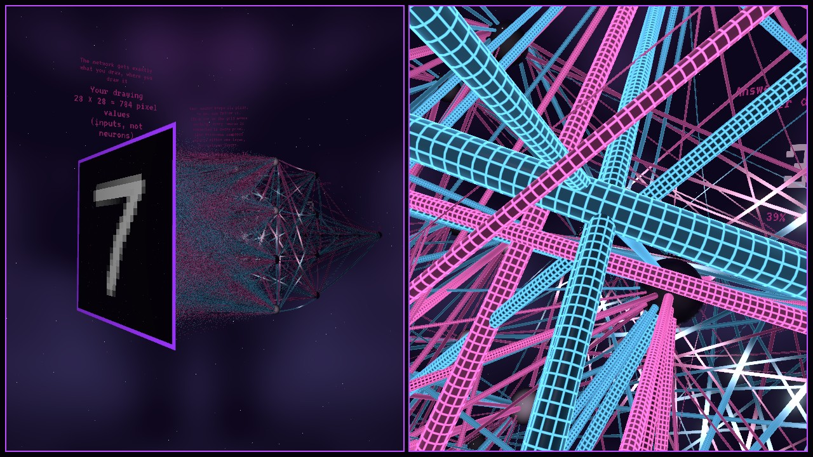

# Inside the Network

A VR exhibit: float inside a real neural network (784 → 16 → 16 → 10, about 13,000
weights), watch it learn, draw digits for it to read, and change its weights by hand.
Everything you see comes from the live model; nothing is faked.

- `server/` – Python (NumPy). Records a full training run as snapshots and serves any
  moment of it: the weights, and how your drawing flows through. The protocol is
  documented at the top of `server/server.py`.
- `godot/` – Godot 4.7 project. Runs on a monitor or in VR (OpenXR, SteamVR).
- `media/` – thumbnails, rendered from the game.

## The space

The network is built very large, so you fly between neurons (about 800 m from the
drawing to the answers). Depth is the order of computation:

1. **Your drawing**: 28 × 28 pixel values (inputs, not neurons) on a black screen
   360 m across.
2. **Hidden layers 1 and 2**: 16 neurons each, in fixed 4 × 4 grids of the same size.
3. **The answer**: ten neurons in a row, 0 to 9.

Every neuron keeps its place for the whole run, so you can follow one through training;
what changes is the connections. A hidden neuron's place in its grid has no meaning:
each one is connected to every pixel, and its weight image (select it) covers almost the
whole digit. Labels in the scene say this.

**Neurons** are black glass balls. Their inner light is their activation for your
drawing; a neuron you switch off glows red. Each incoming line ends at its own point on
the ball's front, laid out like the layer it comes from (28 × 28 for pixels, the 4 × 4
seats for neurons), and outgoing lines leave from the back, laid out like the next layer.
Every outgoing line carries the same value: the neuron's single output.

**Connections** are round tubes:

- **Thickness is proportional to the size of the weight**, on one fixed scale per layer
  for the whole run, so a tube only thickens when its weight really grows. Each layer
  has its own ruler: pixel lines go up to 64 cm, the cables between neurons up to
  4.5 m (both sized so the strongest weights would just cover a ball's face). The
  smallest weights are drawn at 5 cm so they stay visible. A label in the scene says
  thickness compares weights within a layer, not between layers.
- **Colour is the sign**: pink pushes the next neuron on, blue pushes it off.
- **Brightness is the pulse**: when you finish a stroke, your drawing travels through
  layer by layer and each tube glows in proportion to the signal it carries
  (weight × activation, scaled to the strongest signal in its layer for this drawing).
  While the timeline plays, the pulse repeats like a heartbeat.

Decoration that carries no information: the cables between neurons sag and sway slowly
(pixel lines are straight), the tubes' neon grid and rim glow, and the starfield.

**Your drawing** goes in exactly as drawn, where you drew it: no hidden cleanup. The
"Help: centre it" button resizes and centres it like the training digits; it is a good
lesson to see how much worse the network does without that help.

**Editing weights**: grab a line and make its weight stronger or weaker; the network
re-reads your drawing straight away. Edits belong to the training step where you made
them (the recording itself never changes) and "Undo my changes" clears them.

## Run it

1. In a terminal: `cd server`, create a venv (`python -m venv .venv`), activate it
   (`.venv\Scripts\Activate.ps1` in PowerShell), `pip install -r requirements.txt`,
   then `python server.py`. The first run downloads MNIST (about 11 MB) and records the
   standard training run (a few seconds).
2. Open `godot/` in Godot 4.7 and press Play. With a headset connected and SteamVR
   running, it starts in VR; otherwise on the monitor.

## Controls (desktop)

| | |
|---|---|
| Draw (on the input screen or the console board), press buttons, select a neuron, drag the timeline | Left mouse |
| Grab a line, pull yourself along it, let go | Hold left mouse on it, W / S, release |
| Make the held line's weight stronger / weaker | Mouse wheel up / down |
| Switch a hidden neuron off / on | Right mouse on it |
| Play / pause | Space |
| Camera: start position (console) / overview / in front of the input, to draw | 1 / 2 / 3 |
| Look (turn / tilt) | Arrow keys, or middle-drag |
| Fly / up, down / faster | WASD / U, J / hold Shift |
| Bring the console to you | C |
| Print the camera position (to choose a start position) | P |
| Debug: switch every hidden neuron off / back on | K |

Timeline: Start, Reverse, Play, Slower, Faster, End, or drag along the curve.
The curve is the share of test digits answered correctly. Time runs by snapshot, so the
first 200 training steps (where most of the change happens) play in more detail.

Console buttons: Clear board, Show all weights (vs. only what your drawing uses), Train
from scratch (records a new run from random weights), Standard run, Help: centre it,
Undo my changes.

## VR

| | |
|---|---|
| Fly where the left controller points / boost | Left stick / click it in |
| Snap turn 30° / rise, sink | Right stick left, right / up, down |
| Draw, press buttons, select a neuron, drag the timeline | Trigger (laser) |
| Hold on to a cable, pull along it hand over hand | Grip with the hand near the cable (within ~6 m); move the hand |
| Make the held cable's weight stronger / weaker | Either stick up / down |
| Switch a hidden neuron off / on | Grip, pointing at it (within one neuron spacing, ~120 m) |
| Bring the console to you | B on the left controller |

Comfort: you fly where your hand points (look around freely), turns are snap turns, and
the view darkens at the edges while you move or turn. A cable you hold stops swaying.

Technical notes:

- **Renderer**: Direct3D 12 on Windows (`rendering_device/driver.windows`). With Vulkan,
  Godot 4.7 crashed while creating the graphics device through OpenXR (SteamVR 2.17,
  AMD RX 6800). If VR starts in a window instead, check that SteamVR is the active
  OpenXR runtime.
- **Performance** (Bigscreen Beyond 2, 75 Hz, about 9 ms GPU per frame): in VR the render
  scale is 0.75, and MSAA and screen-space reflections are off. FXAA turned the headset
  view black with D3D12, so it is not used.
- **Recording**: in VR the game draws only to the headset, so its own window stays blank
  and OBS captures grey or black. Record SteamVR's VR View window instead (OBS window
  capture, method "Windows 10 (1903 and up)").

## Testing

- Server: `python timeline.py` prints snapshot count and statistics.
- Scripts without a window: `godot --headless --path godot --quit-after 60` catches
  script errors.
- Screenshots: `godot --xr-mode off --path godot -- --screenshot=out.png` draws a test 7,
  saves a picture and prints the frame time. Options: `--at=N` (snapshot), `--pulse=T`
  (freeze the pulse), `--view=1|2|3` or `--cam=x,y,z --look=x,y,z` (network
  coordinates), `--center=1`, `--select=layer,neuron`, `--off=layer,neuron`, `--grab`,
  `--hands`, `--summon`, `--server=ws://…`. Always pass `--xr-mode off`, or it starts a
  VR session. Use a second server (`python server.py --port 8766`) to test without
  disturbing a running one.

## Credits

- Data: MNIST (LeCun, Cortes & Burges). Network size follows 3Blue1Brown's
  "But what is a neural network?".
- Console housing: "computer-wide" from Kenney's Space Station Kit (CC0,
  www.kenney.nl), in `godot/assets/kenney`.
- Console and label font: VT323 by Peter Hull (SIL Open Font License 1.1), in
  `godot/assets/fonts` with its licence.
- VR hands: [Godot XR Tools](https://github.com/GodotVR/godot-xr-tools) 4.5.1 (MIT), in
  `godot/addons/godot-xr-tools`; its hand models by DigitalN8m4r3 are CC0.
